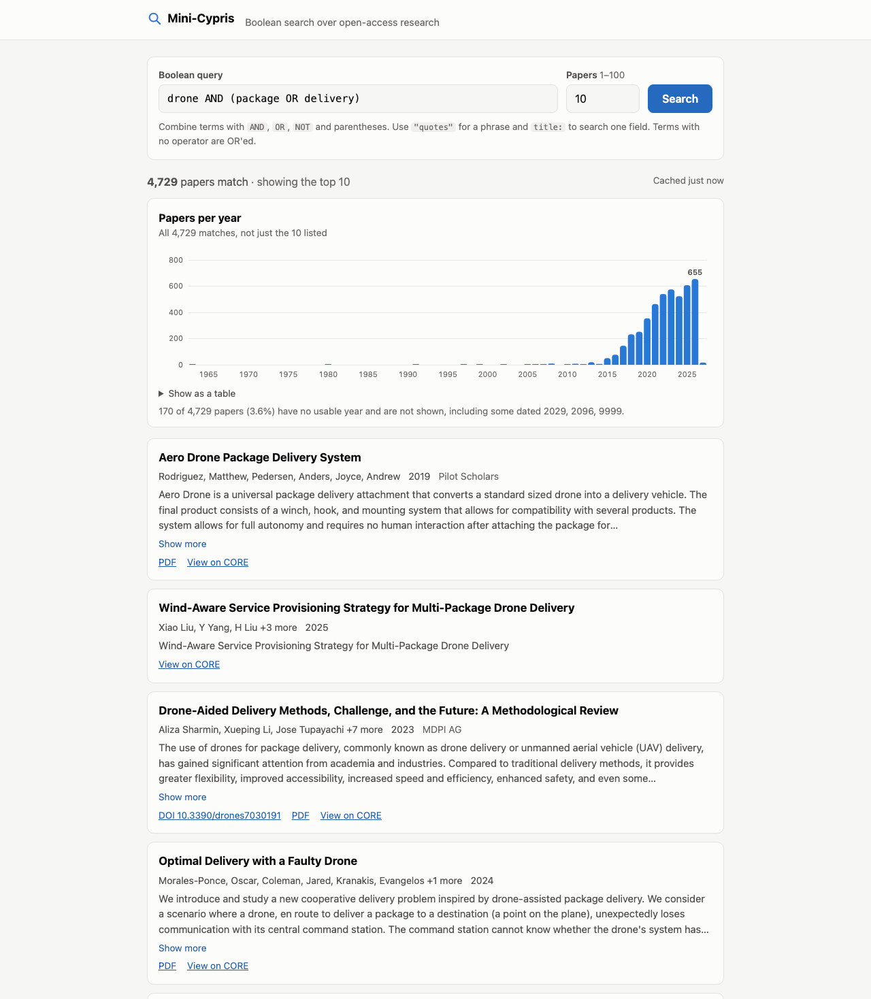

# Mini-Cypris

Search open-access research papers from the [CORE API](https://core.ac.uk/services/api) with boolean queries, and chart how all the matching papers spread over the years. An Angular 22 app on a small Flask service with a SQLite cache.



## Features

- **Boolean search** with `AND`, `OR`, `NOT`, parentheses, `"phrases"` and fields (`title:drone`), for example `drone AND (package OR delivery)`. The query is checked before it reaches CORE, and mistakes come back as a clear message under the search box: `'AND' needs a search term after it (character 8)`.
- **Choose how many papers** come back, from 1 to 100, with validation.
- **Results list:** title (linked to the DOI, otherwise the CORE page), authors, year, publisher, a three-line abstract with *Show more*, and DOI, PDF and CORE links when present.
- **Papers per year chart** for **all** matches, not just the page shown: 4,729 papers for the query above, against the 10 listed. It uses CORE's aggregate endpoint, and a note says how many papers have no usable year.
- **Shareable searches:** the query and count live in the URL (`/?q=...&limit=10`), so a search can be bookmarked, linked, or revisited with Back and Forward.
- **Friendly states:** example queries before the first search, loading skeletons, no matches, CORE down, and a rate-limit countdown ("Retry in 12 s") instead of an error.
- **Fast and polite to CORE:** a SQLite cache answers repeat searches without calling CORE, and a throttle keeps us inside CORE's budget of about 10 requests a minute.
- Responsive down to phone width, light and dark themes, keyboard and screen-reader friendly.

## Run it (Docker, one command)

```bash
docker compose up --build
```

Open http://localhost:8080. Flask serves both the API (`/api/*`) and the built Angular app from one port, so there is no CORS setup. The SQLite cache lives in a Docker volume and survives restarts (`docker compose down -v` clears it).

No CORE API key is needed. To use one, set `CORE_API_KEY` in the environment.

## Run for development

Requirements: **Node 24 LTS** (Angular 22 needs Node `^22.22.3` or `^24.15`) and **Python 3.13**.

Terminal 1: API on port 8000

```bash
cd backend
python3 -m venv .venv
.venv/bin/pip install -r requirements-dev.txt
.venv/bin/flask --app wsgi run --port 8000 --debug
```

Terminal 2: app on port 4200

```bash
cd frontend
npm install
npx ng serve
```

Open http://localhost:4200. The dev server proxies `/api` to port 8000 (`frontend/proxy.conf.json`). Port 8000 is used instead of Flask's default 5000 because macOS uses 5000 for AirPlay.

## Tests

```bash
cd backend && .venv/bin/python -m pytest            # API: 499 tests, no network (CORE is faked)
cd backend && .venv/bin/python -m pytest -m live    # contract checks against the real CORE API (5 requests)
cd frontend && npx ng test --watch=false            # Angular: 27 tests (Vitest)
npx newman run postman/mini-cypris.postman_collection.json -e postman/docker.postman_environment.json   # API contract: 10 requests, 30 assertions
```

The default backend suite never touches the network. It drives the API through a fake CORE that serves real captured responses (`backend/tests/fixtures/`), with a fake clock for cache ages and the throttle window. It also includes a 16-thread stress test of the cache. The Angular tests cover the service (requests and error mapping), the search page (URL flow, validation, every state, retry and countdown) and the chart.

## API

| Method | Path | What it does |
|---|---|---|
| GET | `/api/search?q=&limit=` | Top `limit` papers (1–100, default 10) for a boolean query, through the cache |
| GET | `/api/aggregate?q=` | Papers per publication year across **all** matches of `q`, cached |
| GET | `/api/health` | Service and database status |
| GET | `/api/hello?name=` | Hello-world check from step 1 |

Unknown `/api/*` paths return a JSON `404`. Unexpected errors return a JSON `500`.

### `GET /api/search`

```
GET /api/search?q=drone AND (package OR delivery)&limit=5

200  X-Cache: MISS
{
  "query": "drone AND (package OR delivery)",       // whitespace-normalized, as sent to CORE
  "limit": 5,
  "total_hits": 4729,                               // matches across all of CORE
  "count": 5,
  "results": [{"id": 1, "source": "core", "external_id": "158741339", "title": "...",
               "authors": ["..."], "year": 2019, "publisher": "...", "doi": null,
               "pdf_url": "...", "abstract": "...", "core_url": "https://core.ac.uk/works/158741339"}],
  "cache": {"status": "miss", "fetched_at": 1795131579, "age_seconds": 0, "error": null}
}
```

### `GET /api/aggregate`

```
GET /api/aggregate?q=drone AND (package OR delivery)

200  X-Cache: MISS
{
  "query": "drone AND (package OR delivery)",
  "field": "yearPublished",
  "total_hits": 4729,
  "years": [{"year": 1963, "count": 1}, ..., {"year": 2026, "count": 655}, {"year": 2027, "count": 17}],
  "unknown_year": 170,                              // total_hits minus the year buckets
  "implausible_years": {"2029": 1, "2096": 2, "9999": 1},   // dropped, counted as unknown
  "cache": {"status": "miss", "fetched_at": 1795131590, "age_seconds": 0, "error": null}
}
```

### Errors

| Error | Status | When |
|---|---|---|
| `bad_request` | 400 | `q` missing, blank or over 1000 characters; `limit` not a whole number from 1 to 100 |
| `invalid_query` | 400 | The boolean query is malformed. The body includes `message` and `position` (0-based) |
| `core_rejected_query` | 400 | CORE refused the query, e.g. `TITLE:drone` (field names are case-sensitive) |
| `core_rate_limited` | 429 | Over CORE's budget and nothing cached. `Retry-After` and `retry_after` say when to retry |
| `core_unavailable` | 502 | CORE is down or unreachable, and nothing is cached |
| `core_bad_response` | 502 | CORE answered with something unreadable, and nothing is cached |
| `core_timeout` | 504 | CORE did not answer in time, and nothing is cached |

**Postman:** import `postman/mini-cypris.postman_collection.json` plus one environment (`local-dev` uses port 8000, `docker` uses port 8080). Every request has a saved example response and tests.

## Design decisions

### Architecture

```
Angular 22  ──/api──▶  Flask  ──▶  SQLite cache  ──(miss or stale)──▶  throttle  ──▶  CORE API
```

The browser never calls CORE directly. CORE's CORS policy only allows `http://localhost:4200`, so a hosted frontend couldn't call it anyway. Going through our own API also gives us a cache, one place to respect the rate limit, data cleaning, and stable error messages. In production it is one container: gunicorn (1 worker, 4 threads) serves the API and the built app on `:8080`.

### Cache

`backend/app/cache.py`. Every search goes through SQLite first, and `X-Cache` / `cache.status` say what happened:

| Status | Meaning | CORE calls |
|---|---|---|
| `miss` | Never seen: fetch `limit` rows, store them, serve them | 1 |
| `hit` | Cached, under 24 h old, and deep enough (or CORE has no more rows) | 0 |
| `topup` | Cached and fresh but shallower than `limit`: fetch only the missing rows (`offset` = cached depth) and append them | 1 |
| `refresh` | Older than 24 h: fetch `limit` rows again from rank 1 and replace the list | 1 |
| `stale` | A refresh was needed but CORE failed or was throttled: serve the old list (`cache.error` says why) | 1 failed, or 0 |
| `partial` | A top-up was needed but CORE failed or was throttled: serve the rows we have | 1 failed, or 0 |

- **Key:** the query with whitespace collapsed. Case is kept on purpose: CORE ignores the case of search terms but not of field names (`title:drone` works, `TITLE:drone` is an error), so folding case could merge two different queries.
- **Storage:** each paper is stored once (`papers`, unique per source and id), however many searches find it, and `search_results` holds each search's ranking. The raw CORE record is kept in `raw_json`, so rows can be re-cleaned.
- **Concurrency:** SQLite runs in WAL mode, and every write is one `BEGIN IMMEDIATE` transaction. A fresh list only ever grows (a slow, shallower response never overwrites a deeper one), and a top-up only appends rows past the current depth. Both rules came from races a 16-thread stress test found.
- **Year aggregates** (`backend/app/aggregates.py`) are cached in `aggregates` with the same 24 h freshness. CORE's buckets are stored exactly as sent and filtered when read, so the junk-year rule can change without a refetch.

### Rate limit

CORE's headers advertise 10 requests per short window. In practice we got 429s after about 10 calls in about 60 s, and the penalty lasted up to a minute. `backend/app/throttle.py` therefore gives every outgoing CORE call a slot in a sliding one-minute window, 9 by default, one under CORE's budget (`CORE_RATE_PER_MINUTE`).

- With no slot free, the request **fails fast instead of queueing**, so no server thread waits. Cached rows are still served (`hit`, `stale`, `partial`). Otherwise the API answers 429 with the seconds to wait, and the UI counts down to a Retry button.
- If CORE answers 429 anyway, nothing is sent for 30 s. CORE's own reset header says 0 to 2 s, which is too optimistic, so the user is told the real wait.
- Cache hits and invalid queries cost no slot. A new query costs 2 calls (results plus chart); changing only the count costs at most 1, and 0 if the cache is already deep enough.
- The window lives in process memory, which fits the single gunicorn worker. Several workers or hosts would need a shared store such as Redis.

### Query validation

CORE does not reject a malformed boolean query: `(drone AND ` comes back 200 with results, quietly searching for something other than what was typed. `backend/app/query.py` is a small tokenizer that checks for:

- balanced, non-empty parentheses
- closed, non-empty quotes
- `AND` / `OR` with a term on both sides, and `NOT` with a term after it

Operators count in any case, because CORE treats `and` like `AND`. Each problem gets a message a person can act on, plus a character position. Everything else (field names, wildcards, ranges) is left to CORE, whose rejections come back as `core_rejected_query`. The check runs only on the server, so its messages have one source; the UI shows them under the search box.

### CORE data quality (measured)

| Issue | What we do |
|---|---|
| Abstracts with HTML entities and tags, sometimes double-encoded, sometimes cut off mid-tag (`&lt;p&gt;...&lt;/p`) | Decode (up to twice), strip real-looking tags (so `a < b` survives), drop a cut-off tag at the end, collapse whitespace |
| Author names carrying ids, e.g. `Smith, John (12345)` | Remove `(digits)` |
| Impossible years: 9999, 2096, 2029 | Years later than next year become unknown, in the list and in the chart |
| Papers with no year are in no aggregate bucket (4,559 in buckets vs 4,729 matches) | The chart notes how many papers have no usable year (170 here, 3.6%) |
| An aggregate with no matches is `[]`, not `{}` | Treated as no buckets |
| A query CORE's backend rejects comes back as HTTP **500** (`Azure search failed with status code: 400`) | Reported as `core_rejected_query` (400), not as an outage |
| DOI on about 40% of records, PDF link on about a third | Every result links to its CORE page; DOI and PDF links show when present |
| The same paper can appear twice under different CORE ids (preprint and published version) | Shown as CORE ranks them; see trade-offs |
| CORE truncates some abstracts mid-word | Shown as sent |

## Trade-offs and what I'd do next

- **Duplicates are not merged.** CORE sometimes returns the same work twice, under two ids. Merging on DOI or a normalized title would be easy, but it changes the count the user asked for, so I left the ranking as CORE sends it.
- **The query check is server-only.** It is fast (one request, no CORE call), and keeping one implementation avoids drift. A TypeScript port would give feedback as you type.
- **Throttle and cache are per process.** That fits a single container. Scaling out would mean Redis for the window and Postgres for the cache.
- **Cleaning happens on write.** Rows cached before a rule change pick it up on their next refresh (24 h), and `raw_json` allows a bulk re-clean.
- **Not built:** pagination past 100 results, sorting, filtering by year from the chart, and full text (CORE withholds it from keyless public users).

## Configuration

All optional; set as environment variables.

| Variable | Default | What it does |
|---|---|---|
| `CORE_API_KEY` | none | CORE API key, sent as `Authorization: Bearer`. Works without one. Never logged |
| `CORE_BASE_URL` | `https://api.core.ac.uk/v3` | CORE API root |
| `CORE_TIMEOUT` | `20` | Seconds to wait for CORE to answer (connecting has its own 5 s limit) |
| `CORE_RATE_PER_MINUTE` | `9` | Outgoing CORE calls allowed per sliding minute; `0` turns the throttle off |
| `CACHE_TTL_SECONDS` | `86400` | How long a cached search or aggregate counts as fresh |
| `DATABASE_PATH` | `backend/data/cache.db` | SQLite cache file (`/data/cache.db` in the container) |

## Layout

```
backend/
  app/
    __init__.py     create_app(); serves the built app when FRONTEND_DIST is set
    core_client.py  CORE API client (httpx): requests, errors, rate-limit headers
    throttle.py     sliding-window throttle in front of every CORE call
    cache.py        read-through SQLite cache for searches
    aggregates.py   cached year counts across all matches, unknown-year math
    query.py        boolean query syntax check
    papers.py       CORE record -> papers row -> API shape
    clean.py        entity/tag/author-id/year cleaning
    db.py           SQLite connection; creates the schema on first start
    routes.py       /api endpoints
    schema.sql      database schema
  tests/            pytest; fixtures/ holds real CORE responses
  wsgi.py           entry point (flask run / gunicorn)
frontend/src/app/
  api/              PapersService (HTTP + error mapping) and response types
  search/           search page (form, states, results) and the SVG year chart
postman/            collection + environments
docs/screenshot.png
Dockerfile          builds Angular, then runs Flask + gunicorn on :8080
docker-compose.yml  one service + a volume for the cache
```

## Database

`backend/app/schema.sql`, created automatically on first start:

| Table | Holds |
|---|---|
| `papers` | One row per paper, stored once. Our own `id`; the source's id is `external_id`, unique per `source` |
| `searches` | One row per normalized query: total hits, how many rows are cached, when |
| `search_results` | Which papers a search returned, in rank order |
| `aggregates` | Chart data across all matches: one row per bucket and metric (plus a `totalHits` row per snapshot) |

Timestamps are Unix seconds (UTC).

## Extras beyond the brief

- A Flask API in front of CORE with a SQLite read-through cache: repeat searches skip CORE, a bigger count fetches only the missing rows, and stale results are served if CORE is down.
- A throttle sized to CORE's real budget (about 10 requests a minute, measured), with a friendly countdown in the UI instead of errors.
- Boolean query validation with actionable messages, because CORE silently accepts malformed queries.
- Data cleaning for CORE's quirks (HTML entities, author ids, impossible years) and an honest "unknown year" count on the chart.
- Shareable, bookmarkable searches (state in the URL); light and dark themes; responsive and accessible.
- One-command Docker run, 499 backend tests plus a live contract suite, 27 Angular tests, and a Postman collection with tests.
